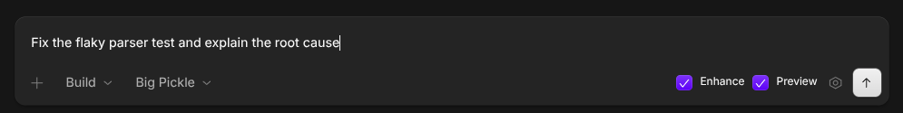
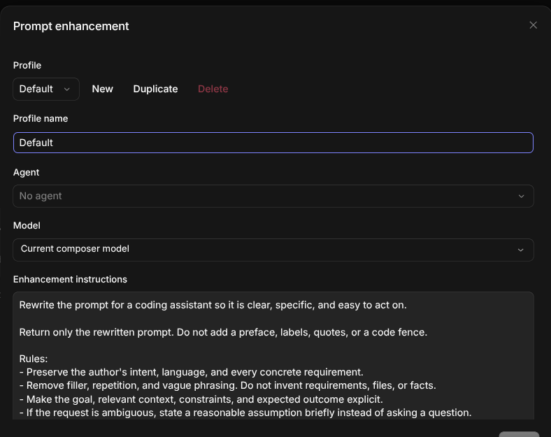
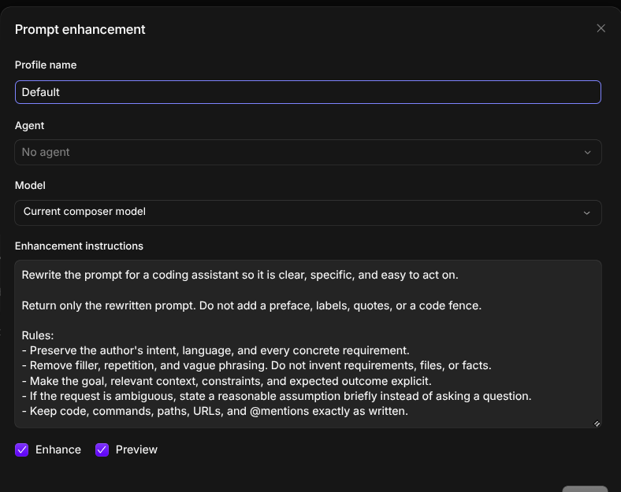
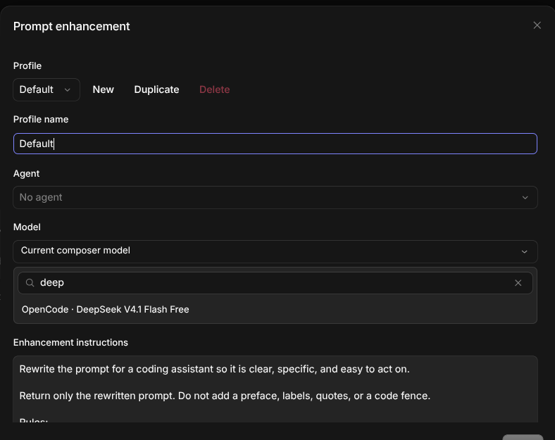
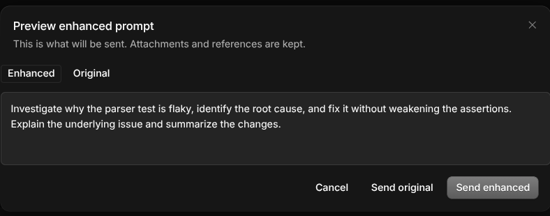

# Prompt Enhancer for OpenCode Desktop

An unofficial patch that adds prompt enhancement to the OpenCode Desktop composer.

Write a rough request, tick **Enhance**, and a model rewrites it before it is sent. Tick
**Preview** to review the rewrite first. Profiles let different kinds of work keep their
own model, agent context, and instructions.



## Features

- **Enhance** and **Preview** toggles in the composer toolbar, next to the send button.
- **Preview dialog** with Enhanced / Original tabs and Send enhanced, Send original,
  or Cancel.
- **Profiles** for different uses, each with:
  - a name,
  - an optional OpenCode agent whose description and system prompt are added as context,
  - a model (or the current composer model),
  - its own enhancement instructions.
- **Searchable model picker** that closes after a selection and shows the saved model
  on the trigger.
- **Wide, resizable instructions box.**
- Attachments, file/skill/session references, and comments are preserved.
- Slash commands and shell mode are sent unchanged.
- A failed enhancement shows a toast and leaves the draft intact.

## Screenshots

### Profiles and settings



### Instructions and toggles



### Searchable model picker



### Preview before sending



## How it works

The patch touches the renderer of OpenCode Desktop 2.3.2:

| Path | Change |
|---|---|
| `packages/app/src/composer/enhance.ts` | settings/profiles, migration, request helpers, prompt rebuild |
| `packages/app/src/composer/enhance-dialog.tsx` | profile, agent, searchable model, settings and preview dialogs |
| `packages/app/src/composer/editor/enhance-controls.tsx` | ticks and cog in the toolbar |
| `packages/app/src/composer/editor/editor.tsx` | renders the controls |
| `packages/app/src/composer/model.ts` | enhances the draft before submit |
| `packages/app/src/composer/enhance.test.ts` | unit tests for the pure helpers |
| `packages/ui/src/i18n/en.ts` | English labels |

The rewrite is requested through OpenCode's local server using
`POST /api/experimental/generate.text`. The rewrite replaces the text of the draft while
keeping its attachments and references. Mentions that disappear from the rewrite are
appended so referenced files and skills remain attached.

Settings and profiles are stored in the renderer's local storage under
`opencode.prompt-enhancer.v1`. A single-profile value from the first version is migrated
automatically.

## Install

Tested against OpenCode Desktop **2.3.2**. Apply the patch to the matching source and
build the desktop app:

```bash
curl -L -o opencode.tar.gz \
  https://codeload.github.com/anomalyco/opencode/tar.gz/refs/tags/v2.3.2
mkdir opencode && tar xzf opencode.tar.gz -C opencode --strip-components=1
cd opencode

git apply /path/to/prompt-enhancer.patch
bun install --frozen-lockfile
OPENCODE_CHANNEL=prod OPENCODE_VERSION=2.3.2 bun run --cwd packages/desktop build
```

### Installing into an existing packaged app

The desktop app loads its renderer from `resources/app.asar`. To update an installed
copy without a full repackage:

1. Back up `resources/app.asar`.
2. Extract the existing asar, preserving its `out/main` (local patches such as window
   transparency live there).
3. Replace only `out/renderer` with the `packages/desktop/out/renderer` produced by the
   build above.
4. Repack the directory with `@electron/asar` and replace `resources/app.asar`.
5. Restart the app.

A published application update replaces `app.asar` and removes the customization, so
reapply the patch after an update.

## Safety and privacy

- The enhancer does not store API keys, tokens, or credentials.
- It uses the OpenCode server already running for the app and the model selected in the
  profile. Prompt text is sent to that model provider only when enhancement runs, just
  like sending the prompt normally.
- Profiles and preferences stay in the app's local storage. No telemetry is added.
- Enhancer failures leave the draft unsent.

## Compatibility

This is a patch, not a fork. It is pinned to OpenCode Desktop 2.3.2 because it changes
renderer internals and relies on the experimental `generate.text` endpoint. A later
upstream release may need the patch adapted.

## License

MIT. See [LICENSE](LICENSE).

OpenCode is © opencode and contributors and is licensed under the MIT License. This
project is unofficial and is not affiliated with OpenCode. The upstream license is
included in [LICENSE-OPENCODE](LICENSE-OPENCODE); see also [NOTICE](NOTICE).
